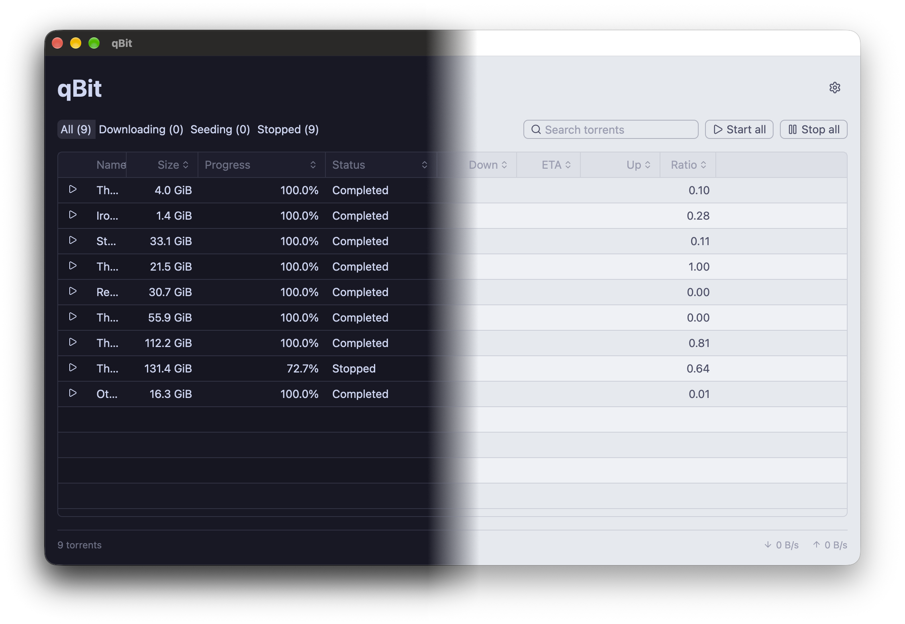

# qBit

[](https://github.com/bobbymannino/qbit/releases/latest)
[](#install)
[](https://www.rust-lang.org/)

A fast, native desktop app for [qBittorrent](https://www.qbittorrent.org/),
written in Rust with [GPUI](https://www.gpui.rs/). It connects to qBittorrent's
Web UI, so you can manage the torrents on your machine or a server from one
small window.



## Install

Download the build for your platform from the [latest
release](https://github.com/bobbymannino/qbit/releases/latest):

### Before you start

qBit talks to qBittorrent's Web UI, so turn that on in qBittorrent first
(**Tools → Options → Web UI**) and note its address, username and password.
You'll enter them the first time you open qBit.

### macOS

1. Open the `.dmg` and drag **qBit** onto the **Applications** shortcut.
2. Eject the disk image.
3. The app isn't notarised, so the first launch is blocked. Open qBit once, then
   go to **System Settings → Privacy & Security** and click **Open Anyway** next
   to the qBit message. Or, from a terminal:

   ```sh
   xattr -dr com.apple.quarantine /Applications/qBit.app
   ```

### Windows

1. Right-click the `.zip` and choose **Extract All…**.
2. Move `qbit.exe` wherever you like, e.g. `%LOCALAPPDATA%\Programs\qBit\`.
3. Run `qbit.exe`. The app isn't signed, so SmartScreen may warn about it: click
   **More info → Run anyway**.
4. Optionally, right-click `qbit.exe` → **Show more options → Pin to Start** (or
   **Send to → Desktop (create shortcut)**).

### Linux

```sh
tar -xzf qBit-<version>-linux-<arch>.tar.gz
cd qBit-<version>-linux-<arch>

# The binary, somewhere on your PATH.
install -Dm755 qbit ~/.local/bin/qbit

# Optional: an entry in your app launcher, with its icon.
install -Dm644 qbit.desktop ~/.local/share/applications/qbit.desktop
install -Dm644 qbit.png ~/.local/share/icons/hicolor/512x512/apps/qbit.png
```

Make sure `~/.local/bin` is on your `PATH`. qBit stores your password in the
system keyring via the Secret Service, so a keyring such as GNOME Keyring or
KWallet needs to be running.

## Updating

Open **Settings** (the gear button, or the shortcut below) and click **Check for
updates**. If there's a newer version, **Install and restart** downloads it,
checks it against its published checksum, and swaps it in for you.

## Keyboard shortcuts

| Action                                   | macOS       | Windows / Linux |
| ---------------------------------------- | ----------- | --------------- |
| Search torrents                          | `⌘ F`       | `Ctrl F`        |
| Back to the torrent list from search     | `Esc`       | `Esc`           |
| Show all / downloading / seeding / stopped | `⌘ 1` – `⌘ 4` | `Ctrl 1` – `Ctrl 4` |
| Move through torrents                    | `↑` `↓`     | `↑` `↓`         |
| Close the details panel                  | `Esc`       | `Esc`           |
| Start or stop the selected torrent       | `Space`     | `Space`         |
| Delete the selected torrent              | `⌘ ⌫`       | `Delete`        |
| Start all torrents                       | `⌥ ⌘ R`     | `Ctrl Alt R`    |
| Stop all torrents                        | `⌥ ⌘ .`     | `Ctrl Alt .`    |
| Open settings                            | `⌘ ,`       | `Ctrl ,`        |
| Close window                             | `⌘ W`       | `Ctrl W`        |
| Quit                                     | `⌘ Q`       | `Ctrl Q`        |

Starting, stopping and deleting the selected torrent work while the torrent list
has focus, so typing a space in the search box doesn't stop anything.

## Building from source

Needs Rust 1.95 or newer (see `rust-version` in `Cargo.toml`). To run it
straight from the repo:

```sh
cargo run
```

To build a release package, run the script for your platform. Each writes its
output to `dist/` and builds for the machine it runs on; set `QBIT_TARGET` to a
Rust target triple to build for another architecture.

```sh
scripts/bundle-macos.sh           # macOS .app and .dmg
scripts/bundle-linux.sh           # Linux tarball
pwsh scripts/bundle-windows.ps1   # Windows zip
```

On Linux you'll need the Wayland, X11 and fontconfig development packages, and
on Windows the MSVC build tools; see `.github/workflows/release.yml` for
details.

## Reporting a problem

Found a bug or want a feature? [Open an
issue](https://github.com/bobbymannino/qbit/issues/new/choose).
